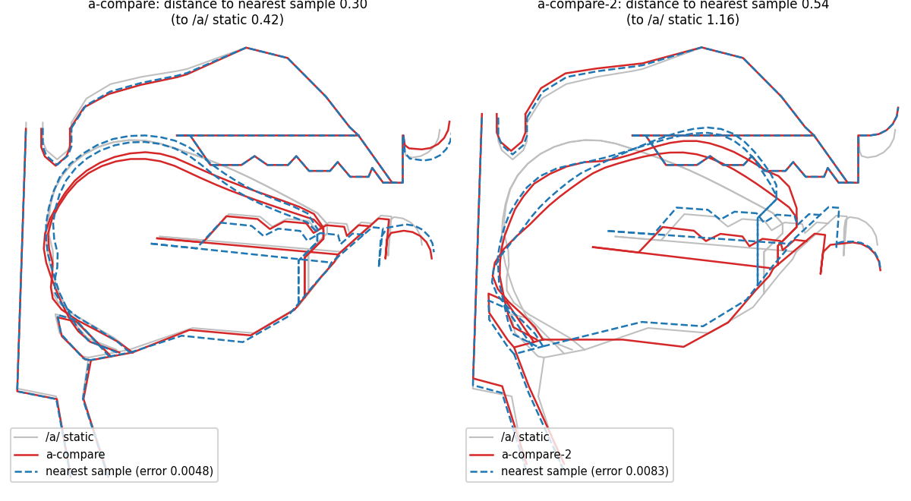
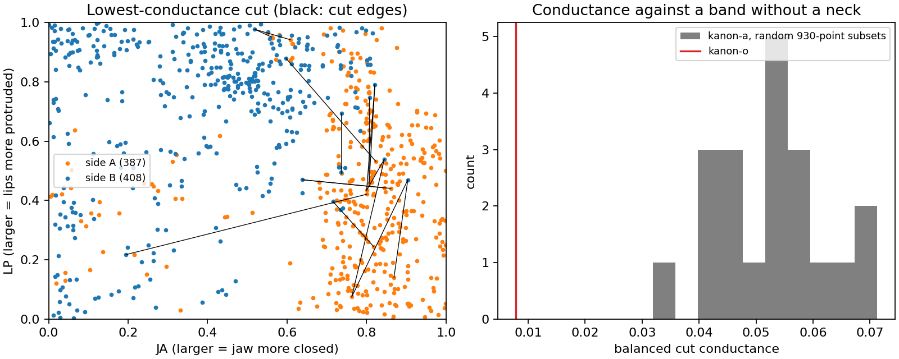
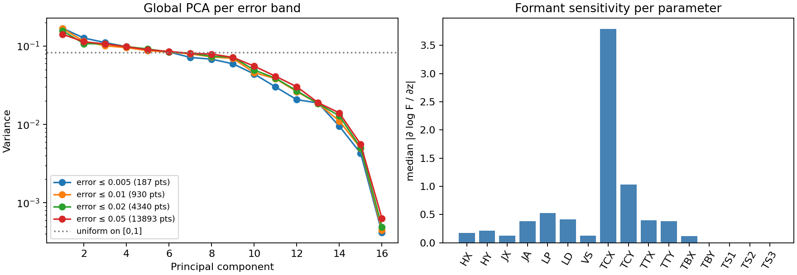

# 嘉音の母音の等フォルマント面の形

嘉音（VTL 2.4、`fulkhisa-kanon-v0-8-vowel-variation.speaker`）の静止母音 /a/ と /o/ について、F1–F3 をほぼ保つ声道形状の集合がどんな形をしているかを調べた。

**/a/ では、誤差 1% の帯は帯の上を歩く経路でほぼ1つにつながり（99.3%）、約13次元の集合だった。舌体中心の2方向がほぼ一定の向きの制約、唇・顎の組み合わせが向きを変える制約になっていた。/o/ は舌体中心の前後（`TCX`）への感度が /a/ の1.5倍で帯がさらに薄く、誤差 1% では80成分に分かれたまま残った。ただし誤差 2% の帯では直線の辺だけでほぼつながる。グラフのコンダクタンスで見ると、/o/ は同じ点数の /a/ の約1/7しかなく、顎を閉じて唇を突き出さない側と、顎を開けて唇を突き出す側の2つの塊が細いくびれでつながった形になっている。どちらの塊も10本の鎖すべてから来ていて、鎖の偏りではない。** H1・H2 にはどちらの母音でもサンプリングの粗さを超える構造は見えなかった。

## 設定

調音パラメータのうち可動な16個（`VO`, `TRX`, `TRY` を除く。`TRX`・`TRY` は話者ファイルで舌体から自動計算）を各可動域で [0,1] に正規化した座標 $z$ を使う。話者の静止母音形状のフォルマント $F^*$ に対し、誤差を $e(z)=\max_i|\log F_i(z)/F_i^*|$ とし、$\{z : e(z)\le\varepsilon\}$ を誤差帯と呼ぶ。

| 母音 | $F^*$ (Hz) |
|---|---|
| /a/ | 852.9, 1528.3, 3652.0 |
| /o/ | 649.7, 1291.2, 3506.6 |

**最小断面積が 0.12 cm² 未満の形状は除外する。** このとき VTL が舌側面パラメータ（`TS2`：舌の奥、`TS3`：舌尖）に応じて断面積を最大 0.15 cm² まで底上げする前の値で判定する（`VocalTract::calcCrossSections`、三角形近似の誤差を補う処理）。底上げ後の値で判定すると、舌が口蓋垂や口蓋に接していても開いて見える。初回の実行はこの判定で行っていて、/o/ の誤差 1% の点の 88%、/a/ の 1% が実際には接触していた。以下はすべて底上げ前の値で判定し直した結果である。

## サンプリング

6温度（0.004〜0.4）のレプリカ交換を10本の鎖で各15000ステップ回し、10ステップごとに誤差 0.05 以下の状態を記録した。8%の確率で一様な大ジャンプを提案する。フォルマント評価1回は約 6〜8 ms、1母音で10コア約12分。

| 誤差帯 | /a/ | /o/ |
|---|---:|---:|
| ≤ 0.005 | 353 | 187 |
| ≤ 0.01 | 2281 | 930 |
| ≤ 0.02 | 9354 | 4340 |
| ≤ 0.05 | 21284 | 13893 |

≤ 0.01 の点の最近傍距離の中央値は /a/ 0.113、/o/ 0.120。

話者ファイルにある比較用の形状のうち、a-compare（/a/ との誤差 0.042）に最も近い ≤ 0.05 のサンプルは 0.29 の距離にある。a-compare-2（誤差 0.047）は 0.51、o-compare（/o/ との誤差 0.003）は 0.45 離れている。o-compare は ≤ 0.005 の帯の中にあるのに近くにサンプルがない。13次元の帯を数千点で覆っても、点と点の間には隙間が残る。



## 連結性

調音空間のユークリッド距離 $r$ でフィルトレーションを入れた。

**Rips（辺の途中を確かめない）**：どの帯も最終的に1成分になり、成分数は $r$ とともになだらかに減る。長く残る2つ目の成分はない。薄い帯で成分数が少ないまま続く段差があるように見えるが、厚い帯から同じ点数を無作為に選ぶと同じ程度の段差が出る（[h0-control.png](results/h0-control.png)、最小全域木の長い辺の上位は /a/ ≤ 0.01 で 0.878, 0.851, 0.824、≤ 0.05 から同数を選んだ20回の平均で 0.913, 0.847, 0.810）。点がまばらなことによるもので、誤差を下げたことによる構造ではない。

**辺の途中を確かめる**：近傍8点（≤ 0.01 は15点）と最小全域木の辺を内部7点で測り、途中も帯に収まる辺だけを残した。

| 誤差帯 | /a/ 成分数 | /a/ 最大成分 | /o/ 成分数 | /o/ 最大成分 |
|---|---:|---:|---:|---:|
| ≤ 0.05 | 16 | 21267（99.9%） | 310 | 12633（91%） |
| ≤ 0.02 | 467 | 6646（71%） | 1170 | 117（3%） |
| ≤ 0.01 | 479 | 1131（50%） | 548 | 22（2%） |

両端が ≤ 0.01 の辺のうち途中も ≤ 0.01 に収まる割合は次のとおり。どちらの母音も長い辺ほど曲がった帯からはみ出し、/o/ の方が低い。

| 辺の長さ | /a/ | /o/ |
|---|---:|---:|
| 0.1 未満 | 82% | 70% |
| 0.1〜0.2 | 70% | 59% |
| 0.2〜0.3 | 47% | 31% |
| 0.3〜0.5 | 19% | 10% |

**帯の上を歩く経路**：分かれた成分を、最も近い別の成分へ歩いてつないだ。目標に向かって 0.02 進み、減衰付きの最小ノルム Gauss–Newton でフォルマント誤差 0.005 以下に引き戻し、直前の点との線分も帯内か確かめる（失敗すれば歩幅を半分に）。つながった成分は合流させ、各成分が最も近い未試行の組を試す回を繰り返す（成分は合流のたびに試行回数を数え直し、6回失敗で打ち切り）。

- **/a/**：479成分が5成分になり、**2266 / 2281 点（99.3%）が1成分**になった。697本中484本が成功し、経路長は直線距離の中央値1.15倍。残りは11点・2点・1点・1点で、11点と2点の成分はどこかのパラメータが可動域の端にある。
- **/o/**：548成分が80成分までしか減らなかった（1657本中481本が成功）。最大成分は267点、続いて141, 107, 62, 52点。大きい成分どうしは主に顎（`JA`）と唇の突き出し（`LP`）の組み合わせで異なる（267点の成分は平均 `JA` 0.41・`LP` 0.77、141点の成分は 0.75・0.25、62点の成分は 0.81・0.28）。`JA` は大きいほど顎が閉じ、`LP` は大きいほど唇が突き出る。つまり、顎を開けて唇を突き出すか、顎を閉じて唇を突き出さないかの補償の違いに当たる。
  - ただし同じ ≤ 0.01 の点どうしを **≤ 0.02 の帯で直線の辺だけでつなぐと 930点中 795点が1成分になり、上の大きい成分はすべてその中に入る。** 分離は ≤ 0.01 と ≤ 0.02 の間でしか起きていない。
  - /o/ の帯は `TCX` 方向の半幅が 0.0023（/a/ は 0.0032）と薄く、歩幅 0.02 の歩き方では帯を外れやすい。成分が本当に分かれているのか、細いくびれなのか、経路の作り方の限界なのかは、この結果からは区別できない。

**くびれ（クラスタリング）**：つながるかどうかではなく、細いくびれで2つの塊に分かれているかを見た。≤ 0.01 の点を、途中が ≤ 0.02 に収まる辺でつないだグラフの最大成分で、両側に20%以上の点を残す切り方のうちコンダクタンス（切る辺の数 ÷ 小さい側の次数の和）が最小のものを Fiedler ベクトルに沿って探した（`cluster.py`）。くびれのない帯との比較には、/a/ の点を /o/ と同じ930点に無作為に間引いた部分グラフを使った（平均次数は /o/ 6.9 に対し 5.8 とほぼ同じ）。

| | 点数 | 平均次数 | 最小コンダクタンス |
|---|---:|---:|---:|
| /a/（全点） | 2280 | 13.8 | 0.086 |
| /a/（930点に間引き、20回） | 約890 | 5.8 | 中央値 0.053（0.032〜0.071） |
| /o/ | 795 | 6.9 | **0.008** |

- **/o/ はくびれのない帯の約1/7のコンダクタンスで、387点と408点の2つの塊に分かれ、その間の辺は19本だけだった。** 2つの塊の違いは顎 `JA`（0.76 vs 0.38）、舌背 `TBX`（0.73 vs 0.41）、唇 `LP`（0.42 vs 0.71）、舌背 `TBY`（0.21 vs 0.45）。経路でつながらずに残った大きな成分（顎を開けて唇を突き出す側と、顎を閉じて唇を突き出さない側）とほぼ同じ分かれ方である。
- /a/ では同じ点数に間引いてもコンダクタンスは 0.03 以上で、くびれは見えない。/a/ の全点で一番小さいのは、舌背が高く（`TBY` 0.70）`TS2` が小さい39点の小さな塊が、≤ 0.015 では辺1本だけで残りとつながる場合だった。
- **2つの塊はどちらも10本の鎖すべてから来ている。** 鎖ごとの点数（塊A / 塊B）は最も偏った鎖でも 13 / 42、ほかは 27 / 32 〜 58 / 33 だった。辺の48%は同じ鎖の点どうしを結んでいて、点は鎖に沿って相関しているが、どの鎖もくびれの両側を訪れている。1本の鎖が探った範囲がたまたま塊に見えているのではない（サンプラーは乱数の種が同じなら同じ点を出すので、鎖の番号を残すように直して /o/ を回し直し、点と誤差が以前と完全に一致することを確かめた上で調べた）。
- /o/ の2つの塊は、≤ 0.01 では経路が見つからず、≤ 0.02 では十数本の辺でつながる。**/o/ の帯は1つにつながっているが、顎・唇・舌背の使い方が違う2つの領域が細いくびれでつながった形**と見るのが、今のデータと一番合う。



## H1・H2

600点に間引いた Rips（farthest point sampling）で H2 まで計算した。最も長いバーは H1 で約 0.18〜0.23、H2 で約 0.10〜0.15、死亡と誕生の比は最大でも約1.3で、多くは H0 の最後の成分がつながる $r \approx 0.6$〜$1.0$ で生まれてすぐ消える。間引きの被覆半径（/a/ ≤ 0.01 で 0.50）と同程度以下で、サンプリングの粗さと区別できない。13次元の集合で穴を判定するには点が桁違いに足りず、半径 0.5 より小さい穴はこの方法では見えない。

## 集合の向き




誤差帯ごとの大域PCAと、≤ 0.01 の約400点で求めた log F の数値ヤコビアン $J$（3×16）の行空間（法線）を比べた。

| | /a/ | /o/ |
|---|---|---|
| 大域PCA 最小3つの分散（≤ 0.01） | 0.0004, 0.0013, 0.0072 | 0.0004, 0.0050, 0.0111 |
| $J$ の特異値（中央値） | 3.12, 0.81, 0.41 | 4.41, 1.35, 0.53 |
| 法線1 | `TCX`, `TCY`（余弦 0.97） | `TCX`（余弦 0.97） |
| 法線2 | `TCY`, `TCX`（余弦 0.73） | `TCY`, `TTX`, `TTY`（余弦 0.64） |
| 法線3 | `LP`, `LD`, `JA`（余弦 0.20） | `LP`, `LD`, `JA`（余弦 0.16） |
| 感度0のパラメータ | `HY`, `TBY`, `TS1`, `TS3` | `TBY`, `TS1`, `TS2`, `TS3` |

余弦はランダムな2点の法線空間の主角の余弦の中央値で、1に近いほど向きが一定。

- **法線1・2**：どちらの母音も舌体中心（`TCX`・`TCY`）で、点が変わってもほぼ同じ向きを保つ。大域PCAの最後の2成分と余弦 1.00, 0.99 で一致する。/o/ は `TCX` への感度が 3.8（/a/ 2.6）と高く、帯がこの方向に特に薄い。
- **法線3**：唇（`LP`, `LD`）と顎（`JA`）の組み合わせで、点ごとに向きが変わる。そのため大域PCAでは1本の段差にならない。
- 感度がほぼ0のパラメータは帯の中で可動域いっぱいに分布する。

どちらの母音でも、等フォルマント面は「舌体中心がほかのパラメータからほぼ線形に決まる14次元の板」の中に、唇・顎による曲がった制約がもう1本かかった約13次元の集合と見るのが自然である。/o/ は板がより薄く、曲がった制約の側で顎と唇の補償の違いが成分の分かれ目として現れている可能性がある。

離れたサンプルを並べた正中断面図（[/a/](results/kanon-a/outlines-spread-0.01.png)、[/o/](results/kanon-o/outlines-spread-0.01.png)）でも、舌体の位置は比較的そろい、顎の開き・唇の突き出し・舌尖が大きく変わる。

## 限界

- 連結性は「つながる経路が見つかった」ことの確認で、つながらなかった成分が別成分である証明ではない。特に /o/ は経路の作り方を変えて確かめる必要がある。
- 点群はレプリカ交換の鎖に沿って相関しており、$r$ の小さい側の H0 や局所PCAは鎖の軌跡の影響を受ける。`sample.py` は各点を見つけた鎖の種を `seeds` として保存する（/o/ のみ記録済み。/a/ の `samples.npz` は記録前のもの）。
- サンプリングの初期点は話者の静止形状で、比較用の形状の近くにはまだ点がない。
- 可動域の端に貼り付いた形状と、内側の形状を区別していない。

## 再現

リポジトリ直下で、NumPy, SciPy, Matplotlib, ripser のある Python を使う。

```sh
clang++ -shared -fPIC -std=c++14 -O2 -w -Ibackend experiments/vowel-topology/measure.cpp $(ls backend/*.cpp | grep -v SoundLib.cpp) -o build-mac/measure.so
cd experiments/vowel-topology
SHAPES="a-compare a-compare-2" sh run.sh a
sh run.sh o
python3 h0_control.py results/h0-control.png
```

`run.sh` はサンプリング（`sample.py`）、Rips（`rips.py`）、法線（`spectrum.py`）、辺の確認（`paths.py`）、帯の上の経路（`connect.py`）、正中断面図（`outlines.py`）を順に回す。`sample.py` は同じ出力先で `--fresh` なしに再実行すると各鎖を続きから延長する。`outlines.py` は VTL API の dylib（`build-mac/gui/libVocalTractLabApi.dylib`）を使う。
