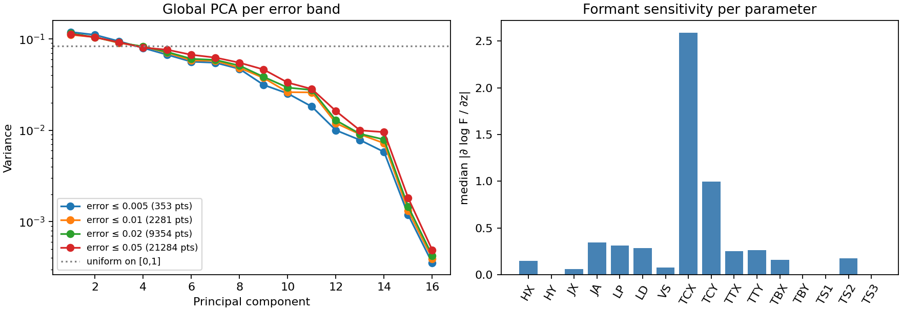

# 嘉音の母音の等フォルマント面の形

嘉音（VTL 2.4、`fulkhisa-kanon-v0-8-vowel-variation.speaker`）の静止母音について、F1–F3 をほぼ保つ声道形状の集合がどんな形をしているかを調べた。**/a/ では、誤差 1% の帯はほぼ1つにつながった約13次元の集合で、舌体中心の2方向がほぼ一定の線形な制約、唇・顎・舌尖の組み合わせが向きを変える曲がった制約になっていた。**

## 設定

調音パラメータのうち可動な16個（`VO`, `TRX`, `TRY` を除く）を各可動域で [0,1] に正規化した座標 $z$ を使う。話者の静止母音形状のフォルマント $F^*$ に対し、誤差を $e(z)=\max_i|\log F_i(z)/F_i^*|$ とし、$\{z : e(z)\le\varepsilon\}$ を誤差帯と呼ぶ。最小断面積が 0.12 cm² 未満の形状は除外した。/a/ の $F^*$ は (852.9, 1528.3, 3652.0) Hz。

## サンプリング

6温度（0.004〜0.4）のレプリカ交換を10本の鎖で各15000ステップ回し、10ステップごとに誤差 0.05 以下の状態を記録した。8%の確率で一様な大ジャンプを提案する。フォルマント評価1回は約 6〜8 ms、10コアで約12分。

| 誤差帯 | 点数 |
|---|---:|
| ≤ 0.005 | 312 |
| ≤ 0.01 | 2287 |
| ≤ 0.02 | 9143 |
| ≤ 0.05 | 20486 |

## 連結性

調音空間のユークリッド距離 $r$ でフィルトレーションを入れた。

**Rips（辺の途中を確かめない）**では、どの帯も最終的に1成分になり、成分数は $r$ とともになだらかに減る（≤ 0.01 では r = 0.5, 0.7, 0.94 で 214, 17, 1）。長く残る2つ目の成分はない。最大成分以外は1〜20点の小群。

**辺の途中を確かめると**、近傍8点と最小全域木の辺を内部7点で測り、途中も帯に収まる辺だけを残した。

| 誤差帯 | 成分数 | 最大成分 |
|---|---:|---:|
| ≤ 0.05 | 21 | 20437 / 20486（99.8%） |
| ≤ 0.02 | 449 | 6242 / 9143（68%） |
| ≤ 0.01（近傍15点） | 492 | 1298 / 2287（57%） |

薄い帯で分かれるのは、直線の辺が曲がった帯からはみ出すためと考えられる。両端が ≤ 0.01 の辺のうち途中も ≤ 0.01 に収まる割合は、長さ 0.1 未満で 82%、0.2〜0.3 で 47%、0.3〜0.5 で 19%。

**帯の上を歩く経路**で残りを確かめた。目標に向かって 0.02 進み、減衰付きの最小ノルム Gauss–Newton でフォルマント誤差 0.005 以下に引き戻し、直前の点との線分も帯内か確かめる（失敗すれば歩幅を半分に）。≤ 0.01 の帯で分かれた491成分のうち、最大成分の最も近い点へ向かう1回目で378、つなぎ先3点・両方向の再試行で計 **484 成分を最大成分につなげ、2277 / 2287 点（99.6%）が1成分**になった。経路長は直線距離の中央値1.11倍。残る7成分は1〜3点で、帯の縁（誤差 0.0097 など）や可動域の端にある点を含み、別成分の証拠とは言えない。

## H1・H2

600点に間引いた Rips（farthest point sampling）で H2 まで、≤ 0.01 の全点で H1 を計算した。最も長いバーは H1 で約 0.2、H2 で約 0.12 で、多くは r ≈ 0.5 で生まれる。最近傍距離の中央値（0.14〜0.19）や間引きの被覆半径（0.48〜0.70）と同程度以下で、サンプリングの粗さと区別できない。13次元の集合で穴を判定するには点が桁違いに足りず、高次のホモロジーはこの方法では調べられない。

## 集合の向き



誤差帯ごとの大域PCAでは、最小の2つの分散（≤ 0.01 で 0.0004, 0.0013）だけが明確に小さく、その次は 0.0066, 0.0079, 0.0119 となだらかに続く。≤ 0.01 の400点で log F の数値ヤコビアン $J$（3×16）を求め、その行空間を法線とした。

- 法線1・2はほぼ `TCX`・`TCY`（舌体中心）の方向で、点が変わってもほぼ同じ向き（ランダムな2点の法線空間の主角の余弦の中央値 0.97, 0.72）。大域PCAの最後の2成分と余弦 1.00, 0.98 で一致する。感度 $|\partial\log F/\partial z|$ の中央値も `TCX` 2.6、`TCY` 1.0 と突出する。
- 法線3は唇（`LP`, `LD`）・顎（`JA`）・舌尖（`TTX`, `TTY`）の組み合わせで、点ごとに向きが変わる（余弦 0.20）。そのため大域PCAでは1本の段差にならず、12〜14番目に分散が広がる。
- `HY`, `TBY`, `TS1`, `TS3` はこの領域で感度がほぼ0で、帯の中で一様に分布する（標準偏差 0.28〜0.30、一様分布は 0.289）。

/a/ の等フォルマント面は、舌体中心がほかのパラメータからほぼ線形に決まる14次元の板の中で、唇・顎・舌尖による曲がった制約がもう1本かかった約13次元の集合と見るのが自然である。

## 限界

- 連結性は「つながる経路が見つかった」ことの確認で、残った7成分が別成分でないことは示していない。≤ 0.005 では未確認。
- 点群はレプリカ交換の鎖に沿って相関しており、局所PCAは鎖の軌跡の影響を受ける。
- サンプリングの初期点は話者の静止形状で、可動域の端に貼り付いた形状の扱いは区別していない。

## 再現

リポジトリ直下で、NumPy, SciPy, Matplotlib, ripser のある Python を使う。

```sh
clang++ -shared -fPIC -std=c++14 -O2 -Ibackend experiments/vowel-topology/measure.cpp build-mac/gui/libVocalTractLabApi.dylib -Wl,-rpath,@loader_path/gui -o build-mac/measure.so
cd experiments/vowel-topology
for k in 1 2 3 4 5; do python3 sample.py --vowel a --seeds $(seq 42 51) --steps 3000 --workers 10; done
python3 rips.py results/kanon-a/samples.npz --tolerances .01 .05
python3 spectrum.py results/kanon-a/samples.npz
python3 paths.py results/kanon-a/samples.npz
python3 paths.py results/kanon-a/samples.npz --cap .01 --neighbours 15 --out results/kanon-a/samples-edges-0.01.npz
python3 connect.py --samples results/kanon-a/samples.npz
```

`sample.py` は同じ出力先で再実行すると各鎖を続きから延長する。
